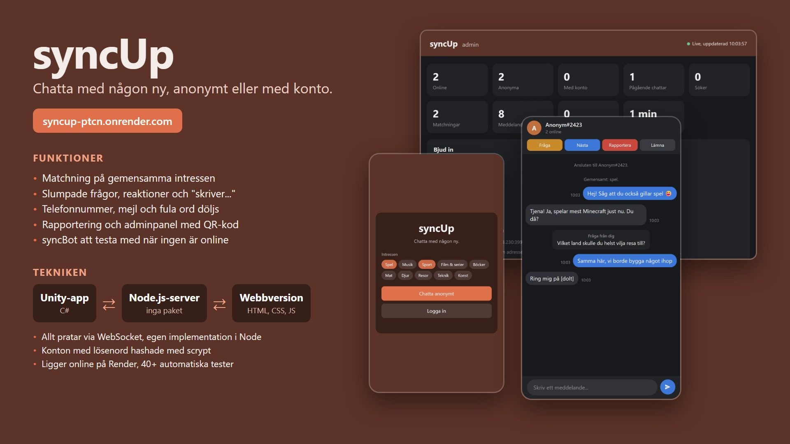

# syncUp

## Beskrivning

Skolprojekt. En chatt där man pratar med någon slumpad, anonymt eller med konto. Finns som app i Unity och som hemsida, och båda kan chatta med varandra.

## Testa direkt

**https://syncup-ptcn.onrender.com**

Inget behöver installeras. Öppna länken i två flikar (eller på datorn och mobilen) för att chatta med dig själv, eller tryck **Bot** för att prata med testboten. Servern somnar när ingen använt den på en stund, så första laddningen kan ta upp till en minut.

Film: [docs/syncUp.mp4](docs/syncUp.mp4)

## Funktioner

- Matchning på gemensamma intressen
- Slumpade frågor att prata om, reaktioner och "skriver..."
- Telefonnummer, mejl och fula ord döljs
- Rapportering och adminpanel med QR-kod för att bjuda in
- syncBot att testa med när ingen annan är online

## Teknik

- **Server:** Node.js utan några paket. Egen WebSocket-server (`server/miniws.js`).
- **Webb:** HTML, CSS och JavaScript (`server/public/`).
- **App:** Unity 6 och C# (`Assets/Scripts/`).
- **Konton:** sparas i en JSON-fil, lösenord hashade med scrypt.
- **Drift:** Render, uppdateras automatiskt från GitHub.

## Filer

| Mapp | Innehåll |
|---|---|
| `server/` | Servern, adminpanelen och tester |
| `server/public/` | Webbversionen |
| `Assets/` | Unity-projektet |
| `docs/` | Bild och film |

## Köra lokalt

Kräver [Node.js](https://nodejs.org). Dubbelklicka på `Starta syncUp.bat` eller tryck Play i Unity.

Tester: `cd server` och `npm test`.
